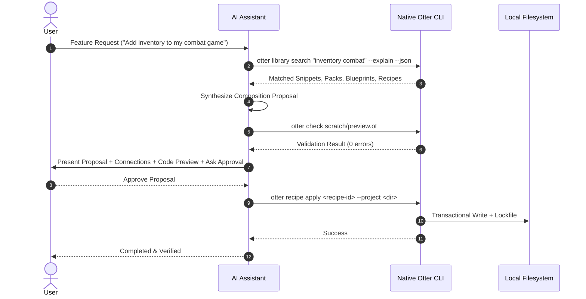

# Otter AI Composition Protocol Specification

**Status:** Official Specification  
**Version:** 1.0.0  
**Target:** Otter 1.0.1 Native Library Ecosystem  

---

## 1. Objective

The **Otter AI Composition Protocol** establishes a provider-independent standard for AI coding assistants (such as Google Antigravity, OpenAI, Claude, or local LLMs) to discover, recommend, assemble, and preview reusable Otter library components without bypassing compiler validation or inventing unsupported syntax.

---

## 2. Core Constraints

1. **No Language Alterations:** The AI assistant MUST adhere strictly to canonical Otter 1.0.1 syntax:
   - `property of object` (NO dot syntax `.` for property access).
   - Standalone `.` for statement and block termination.
   - List operations: `items are empty`, `add item to items`, `length of items`.
   - Function definitions: `to functionName p1 p2 ... return val .`.
   - Never generate unsupported tokens (`new`, `class`, `import`, `def`).
2. **Deterministic Offline Discovery First:** The AI MUST query the local catalog (`otter library search "<intent>" --explain --json`) before inventing custom logic.
3. **Approval Gate:** The AI MUST NEVER write generated files to disk without presenting a structured proposal and receiving explicit user approval.
4. **Automated Verification:** All proposed code MUST be verified with `otter check <file.ot>` or `otter run <file.ot>` before execution.

---

## 3. Protocol Workflow (8 Steps)



### Step 1: Read Available Library Metadata
The assistant inspects local library components:
```bash
otter library search "<intent query>" --explain --json
```

### Step 2: Interpret Feature Request
The assistant extracts required capabilities:
- Target runtime: `console`, `desktop`, `server`, or `game`.
- Required domains: `math`, `text`, `files`, `entities`, `network`.

### Step 3: Recommend Existing Components
The assistant ranks matched components from:
- **Snippets:** Micro-patterns (e.g. `math-clamp`, `game-actor-init`).
- **Packs:** Tested reusable modules (e.g. `otter-official/game-entity`).
- **Blueprints:** Composition topologies (e.g. `otter-official/game-combat`).
- **Recipes:** Complete multi-blueprint apps (e.g. `otter-official/rpg-adventure`).

### Step 4: Produce Structured Composition Proposal
The assistant generates a JSON payload adhering to `library/schema/composition-proposal.schema.json`.

### Step 5: Explain Component Connections
The assistant outlines data flows and interface bindings between modules.

### Step 6: Preview Generated Source Code
The assistant provides full code previews with source mappings indicating provenance:
```otter
# [Source: otter-official/game-entity v1.1.0]
hero is createActor "Aria" 100 1
bag is createInventory 8

# [Source: otter-official/game-combat 1.0.0]
remHp is applyDamage enemy 35
```

### Step 7: Request Approval
The assistant stops and requests user confirmation prior to creating or overwriting files.

### Step 8: Validate Generated Code
The assistant runs native CLI verification:
```bash
otter check <target-file.ot>
```

---

## 4. Verification & Testing

Every proposal can be validated offline by running:
```bash
otter recipe plan <recipe-id> --project <dir> --json
```
And verified post-apply using:
```bash
otter recipe verify --project <dir>
```
