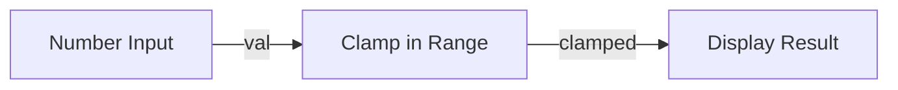

# Console Calculator Blueprint

**ID:** `otter-official/console-calculator`  
**Version:** `1.0.0`  
**Targets:** `console`  
**Dependencies:** `otter-official/math-utils` (v1.0.0)

## Overview

Demonstrates range clamping and mathematical boundary enforcement using `otter-official/math-utils`.

