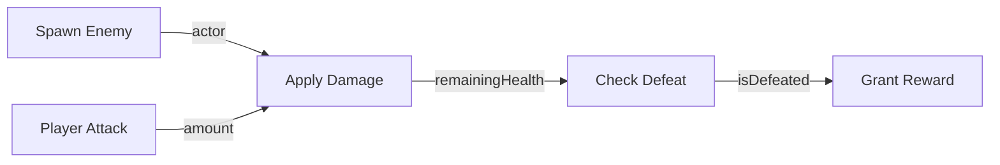

# RPG Combat Starter Blueprint

**ID:** `otter-official/game-combat`  
**Version:** `1.0.0`  
**Targets:** `console`, `game`  
**Dependencies:** `otter-official/game-entity` (v1.0.0), `otter-official/math-utils` (v1.0.0)

## Overview

The RPG Combat Starter Blueprint provides a complete, tested battle cycle for turn-based and action RPGs in Otter:

1. **Entity Initialization:** Spawns an enemy actor with configurable health.
2. **Damage Application:** Deducts player damage using safe bounded arithmetic.
3. **Defeat Condition:** Evaluates whether remaining health reached 0 and updates alive status.
4. **Reward Trigger:** Emits victory and experience rewards.

## Visual Wiring Graph

## Generated Code

Installs `src/combat.ot` into the target Otter project using standard relative `use` statements.
