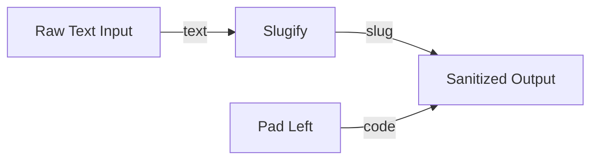

# Text Sanitization and Slug Generator Blueprint

**ID:** `otter-official/text-cleanup`  
**Version:** `1.0.0`  
**Targets:** `console`, `desktop`, `web`  
**Dependencies:** `otter-official/text-utils` (v1.0.0)

## Overview

Processes raw user strings into URL-friendly slugs and standardized fixed-width identifier codes using `otter-official/text-utils`.

