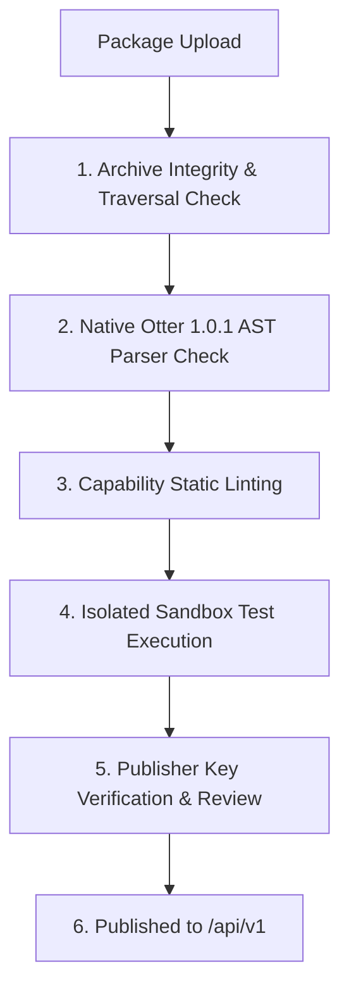

# Otter Online Registry & Website Specification (Phase 2 & Beyond)

**Document Version:** 1.0.0  
**Status:** Approved Architecture Specification  
**Target:** `otterprogramming.com`, `Otter.Cli`, and `Otter Studio`  
**Date:** 2026-11-10  
**Compatibility:** Strict Otter 1.0.1 syntax; zero runtime dependency on registry for execution.

---

## 1. Executive Summary & Design Principles

The Otter Online Registry provides an immutable, cryptographically verifiable distribution system for Otter Snippets, Source Packs, and Visual Blueprints at `https://otterprogramming.com/api/v1`.

### Core Architectural Pillars
1. **Offline-First & CLI Independence (Section 15 Amendment):**
   - The registry is an optional discovery and transport layer.
   - Once a package or blueprint is fetched and recorded in `otter.lock`, all compilation, validation, and execution run completely offline without network access.
   - The native C# `otter` CLI and PowerShell tool can consume local package directories, air-gapped bundles, or private network mirrors without contacting `otterprogramming.com`.
2. **Cryptographic Provenance:**
   - Every published artifact is anchored by an Ed25519 publisher signature and a SHA-256 Subresource Integrity (SRI) digest.
   - Lockfile entries (`otter.lock`) use the exact same SHA-256 digest calculated by the registry.
3. **Automated Static Security & Capability Linting:**
   - Manifests declare granular capabilities (`files`, `network`, `database`, `system`).
   - Every submission passes through an AST static analysis pipeline that scans for undeclared system calls, path escapes, or unauthorized process invocations before reaching the catalog.
4. **Gated Community Publishing:**
   - To prevent supply-chain attacks and ecosystem spam, arbitrary anonymous or unverified community publishing is blocked by default in MVP.
   - Only audited `otter-official/` packages and verified partner keys are published initially.

---

## 2. Registry REST API Specification (`/api/v1`)

All endpoints are hosted at `https://otterprogramming.com/api/v1` (with local staging at `http://localhost:5000/api/v1`).
All JSON responses return UTF-8 encoded text with standard headers:
- `Content-Type: application/json; charset=utf-8`
- `Cache-Control: public, max-age=300` (for search/index)
- `Cache-Control: public, max-age=31536000, immutable` (for version-pinned manifests and tarballs)

### 2.1 Packages API

#### `GET /api/v1/packages`
Search and list published packages.
- **Query Parameters:**
  - `q` (string, optional): Search query matching name, title, description, or tags.
  - `category` (string, optional): e.g., `math`, `text`, `collections`, `game`, `io`.
  - `target` (string, optional): e.g., `console`, `desktop`, `web`, `game`.
  - `capability` (string, optional): Filter by declared capability (e.g., `none`, `files`, `network`).
  - `page` (int, default: 1): Page number (20 items per page).
- **Response `200 OK`:**
```json
{
  "total": 5,
  "page": 1,
  "pageSize": 20,
  "items": [
    {
      "id": "otter-official/math-utils",
      "publisher": "otter-official",
      "name": "math-utils",
      "version": "1.0.0",
      "title": "Otter Math Utilities",
      "summary": "Essential numerical algorithms, interpolation, clamping, and statistics.",
      "license": "MIT",
      "capabilities": [],
      "targets": ["console", "desktop", "web", "game"],
      "verified": true,
      "updatedAt": "2026-11-10T12:00:00Z"
    }
  ]
}
```

#### `GET /api/v1/packages/:publisher/:name`
Retrieve package overview, available versions, and documentation.
- **Response `200 OK`:**
```json
{
  "id": "otter-official/math-utils",
  "publisher": "otter-official",
  "name": "math-utils",
  "latest": "1.0.0",
  "versions": ["1.0.0"],
  "title": "Otter Math Utilities",
  "description": "Essential mathematical functions including clamp, lerp, and range mapping.",
  "readme": "# Otter Math Utilities\n...",
  "license": "MIT",
  "repository": "https://github.com/Heavens-Lava/otter-net",
  "capabilities": [],
  "verified": true
}
```

#### `GET /api/v1/packages/:publisher/:name/:version`
Retrieve the exact immutable manifest (`otter.pack.json`) and cryptographic verification metadata.
- **Response `200 OK`:**
```json
{
  "schemaVersion": 1,
  "name": "math-utils",
  "publisher": "otter-official",
  "version": "1.0.0",
  "kind": "pack",
  "title": "Otter Math Utilities",
  "entry": "src/main.ot",
  "capabilities": [],
  "integrity": {
    "sha256": "4a5c89e276f5b9d3e7f...",
    "sri": "sha256-SlyJ4nb1udPn/...",
    "ed25519Signature": "MEUCIQD...3b2==",
    "publicKeyId": "key-otter-official-2026"
  },
  "dependencies": {},
  "downloadUrl": "https://otterprogramming.com/api/v1/packages/otter-official/math-utils/1.0.0/download"
}
```

#### `GET /api/v1/packages/:publisher/:name/:version/download`
Downloads the immutable gzipped tarball (`.tar.gz`) containing the package source tree (`otter.pack.json`, `src/`, `examples/`, `tests/`).
- **Response `200 OK`:** `application/gzip` with headers:
  - `Content-Disposition: attachment; filename="otter-official-math-utils-1.0.0.tar.gz"`
  - `ETag: "4a5c89e276f5b9d3e7f..."`

---

### 2.2 Blueprints API

#### `GET /api/v1/blueprints`
Search and list published visual blueprints.
- **Query Parameters:** `q`, `target`, `page`.
- **Response `200 OK`:**
```json
{
  "total": 4,
  "page": 1,
  "pageSize": 20,
  "items": [
    {
      "id": "otter-official/game-combat",
      "version": "1.0.0",
      "title": "RPG Combat Starter",
      "summary": "Connect damage, health, cooldown, and defeat logic into an interactive combat loop.",
      "targets": ["console", "game"],
      "packs": [
        { "id": "otter-official/math-utils", "version": "1.0.0" },
        { "id": "otter-official/game-entity", "version": "1.0.0" }
      ],
      "nodeCount": 4,
      "edgeCount": 3,
      "verified": true
    }
  ]
}
```

#### `GET /api/v1/blueprints/:publisher/:name/:version`
Retrieve the complete blueprint manifest (`otter.blueprint.json`), including nodes, edges, generated file templates, explanations, and test suites.

---

### 2.3 Snippets API

#### `GET /api/v1/snippets`
Query the central snippet index. Returns the 38 canonical snippets grouped by category and tags.

#### `GET /api/v1/snippets/:id`
Retrieve a single snippet definition with template, runnable example, and capability requirements.

---

## 3. Cryptographic Verification & Trust Model

### 3.1 Ed25519 Signing Pipeline
Every package and blueprint release artifact is signed by the publisher's Ed25519 private key prior to publishing:
```text
[Source Tree] ---> Tarball (.tar.gz) ---> SHA-256 Digest ---> Ed25519 Sign ---> Signature File (.sig)
```

1. **Official Trusted Roots:**
   - Both `otter-net` (`src/Otter.Cli`) and `otter-library.ps1` embed the official Otter public key:
     `ed25519:otter-official:MCowBQYDK2VwAyEANkF5+9Q8q4v2...`
2. **Lockfile Enforcement (`otter.lock`):**
   - When `otter pack install` or `otter blueprint apply` is run, the engine computes the SHA-256 checksum of the extracted package entry point and archive.
   - If the local file checksum differs from `otter.lock`, installation is aborted with `[CORRUPT: CHECKSUM MISMATCH]`.
   - Tampered packages are never executed.

---

## 4. Static Malware & Capability Analysis Pipeline

Before any package is indexed or made downloadable on `otterprogramming.com`, it must pass through an automated validation sandbox:



### 4.1 Check 1: Archive Safety & Path Traversal
- Rejects any archive containing:
  - Absolute paths (`/etc/...`, `C:\...`).
  - Directory traversal sequences (`..`).
  - Symlinks, hardlinks, or device nodes.
  - Files outside `src/`, `examples/`, `tests/`, `README.md`, `LICENSE`, `otter.pack.json`.
  - Executable binaries, DLLs, `.so`, `.dylib`, or shell scripts.

### 4.2 Check 2: Native AST Parsing
- The package entry (`src/main.ot`) and all included `.ot` files are parsed with `Otter.Language.Parser` from `otter-net`.
- Verifies strict Otter 1.0.1 compliance:
  - No unsupported syntax or experimental grammar.
  - Correct `property of object` syntax; zero dot-member notation.
  - Standalone `.` used only as block terminators.

### 4.3 Check 3: Capability Static Linting
- The static analyzer verifies that the declared `capabilities` match the AST:
  - If the code uses `listen for`, `receives GET`, or network constructs, `capabilities` **must** include `"network"`.
  - If the code uses `write file`, `read file`, or `watch file`, `capabilities` **must** include `"files"`.
  - If the code uses `connect to sqlite` or SQL queries, `capabilities` **must** include `"database"`.
  - Any undeclared capability access causes an immediate security rejection.

### 4.4 Check 4: Isolated Headless Test Execution
- The package's `tests/test.ot` is executed in an ephemeral, resource-constrained container (max 50MB RAM, max 5s CPU, zero network egress).
- Tests must pass with exit code `0` and zero uncaught exceptions.

---

## 5. Website Discovery Wireframes (`otterprogramming.com`)

### 5.1 Package Directory (`otterprogramming.com/packages`)

```text
+-----------------------------------------------------------------------------------+
|  OTTER LOGO      Documentation    Packages    Blueprints    Playground    GitHub  |
+-----------------------------------------------------------------------------------+
|                                                                                   |
|   Reusable Source Packs for Otter 1.0.1                                           |
|   Secure, offline-first, verified modular source code.                            |
|                                                                                   |
|   +-----------------------------------------------------------------------+       |
|   | [Search packs by name, keyword, or capability...]           [Search]  |       |
|   +-----------------------------------------------------------------------+       |
|                                                                                   |
|   Filter: [All Targets v]  [All Categories v]  [x] Verified Only  [ ] Offline Ready|
|                                                                                   |
|   +------------------------------------+  +------------------------------------+  |
|   | otter-official/math-utils   v1.0.0 |  | otter-official/game-entity  v1.0.0 |  |
|   | [VERIFIED]  [CAPABILITIES: NONE]   |  | [VERIFIED]  [CAPABILITIES: NONE]   |  |
|   |------------------------------------|  |------------------------------------|  |
|   | Essential clamp, lerp, range map,  |  | Actor stats, health management,    |  |
|   | and numerical analysis routines.   |  | inventory capacity, and cooldowns. |  |
|   |                                    |  |                                    |  |
|   | Targets: console, desktop, web     |  | Targets: console, game             |  |
|   | Install: otter pack install ...    |  | Install: otter pack install ...    |  |
|   +------------------------------------+  +------------------------------------+  |
|                                                                                   |
|   +------------------------------------+  +------------------------------------+  |
|   | otter-official/text-utils   v1.0.0 |  | otter-official/file-helpers v1.0.0 |  |
|   | [VERIFIED]  [CAPABILITIES: NONE]   |  | [VERIFIED]  [CAPABILITIES: FILES]  |  |
|   +------------------------------------+  +------------------------------------+  |
|                                                                                   |
+-----------------------------------------------------------------------------------+
```

### 5.2 Blueprint Visual Explorer (`otterprogramming.com/blueprints`)

```text
+-----------------------------------------------------------------------------------+
|  OTTER LOGO      Documentation    Packages    Blueprints    Playground    GitHub  |
+-----------------------------------------------------------------------------------+
|                                                                                   |
|   Interactive Visual Blueprints                                                   |
|   Connect trusted Packs visually, inspect data flow, and generate pure Otter code.|
|                                                                                   |
|   +---------------------------------------------------------------------------+   |
|   | Blueprint: otter-official/game-combat (v1.0.0)             [Export Code]  |   |
|   +---------------------------------------------------------------------------+   |
|   |                                                                           |   |
|   |   VISUAL DATA FLOW GRAPH:                                                 |   |
|   |                                                                           |   |
|   |   +----------------+          +-----------------------+                   |   |
|   |   | [input] attack |          | [pack-call] apply     |                   |   |
|   |   |   damage: 25   |--------->| (game-entity)         |                   |   |
|   |   +----------------+          |   in: amount (25)     |                   |   |
|   |                               |   out: remaining (75) |----+              |   |
|   |                               +-----------------------+    |              |   |
|   |                                                            v              |   |
|   |                                               +-----------------------+   |   |
|   |                                               | [condition] defeat    |   |   |
|   |                                               |   in: health (75)     |   |   |
|   |                                               +-----------------------+   |   |
|   |                                                                           |   |
|   |---------------------------------------------------------------------------|   |
|   | GENERATED OTTER SOURCE PREVIEW:                                           |   |
|   |                                                                           |   |
|   |   use ".otter/packages/otter-official/game-entity/1.0.0/src/main.ot"      |   |
|   |   enemy is an Actor                                                       |   |
|   |   health of enemy is 100                                                  |   |
|   |   enemy is applyDamage enemy and 25                                       |   |
|   |   if health of enemy is at most 0                                         |   |
|   |       say "Enemy defeated!"                                               |   |
|   |   .                                                                       |   |
|   +---------------------------------------------------------------------------+   |
+-----------------------------------------------------------------------------------+
```

---

## 6. Security Governance & Supply Chain Controls

1. **Immutable Package Versions:**
   - Once a version `X.Y.Z` is accepted into the registry, its content, hash, and archive can **never** be replaced, edited, or re-uploaded.
   - Any bug fix requires a semver bump (e.g., `1.0.1`).
2. **Deterministic Offline Restores:**
   - The CLI never contacts the registry if all packages in `otter.lock` are already present in local `.otter/packages/` or the user's global cache `~/.otter/cache/packages/`.
3. **No Automatic Script Execution:**
   - Neither downloading, inspecting, nor applying a pack or blueprint executes external shell commands, build scripts, or arbitrary hooks.
   - Only native Otter code is executed, under full user transparency and control.
